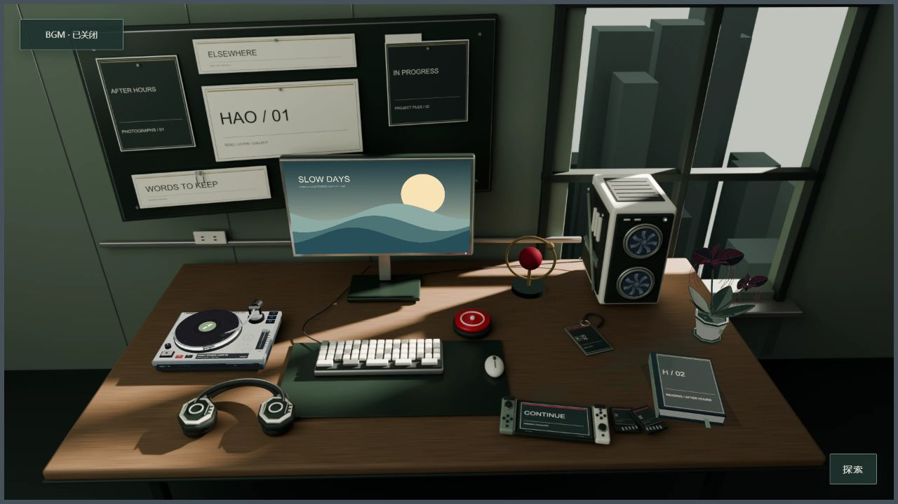

# HAO's Treehole / 交互式桌面树洞

A local-first 3D desktop for reading, music and personal collections. Vanilla JavaScript, Three.js and a static Node server. **No AI API, backend account, database service or paid key required.**

一个可以读书、听歌、收藏图片、切换世界的个人桌面。当前公开版附带两套原创演示素材：**绯红夜航**与**日光工作室**。功能与私人版共用实现，插画、角色和商业音乐已替换为可分发的原创内容。



## 直接运行

安装 [Node.js](https://nodejs.org/) 20 或更高版本与 Git，然后执行：

```sh
git clone https://github.com/Hao-moon/hao-treehole.git
cd hao-treehole
node server.mjs
```

打开 **http://127.0.0.1:4173/**。第二世界直达：**http://127.0.0.1:4173/?world=ghostblade**。

运行所需的浏览器依赖和演示资源都已包含，首次启动不需要 `npm install`，不需要 Blender。不使用 Git 也可以选择 GitHub 的 **Code → Download ZIP**，解压后在目录中运行 `node server.mjs`。

端口冲突时，Windows PowerShell 用 `$env:PORT=4176; node server.mjs`；macOS/Linux 用 `PORT=4176 node server.mjs`。服务器默认只监听本机，不会自动对外公开。

## 可以做什么

- 点击桌面物件进入相应界面；拖动环顾、滚轮缩放，「探索」提供所有入口。
- 书本支持 TXT / EPUB、本地书架、阅读位置、目录、书签、文字设置和纸页动画。点击左右页的阅读区域翻页。
- 唱片机支持内置原创音频、本地导入、播放控制和收藏；耳机提供合成环境声景。
- 屏幕支持自定义图片、取景和轮换；植物支持轻碰叶片与更换品种。
- 墙面收藏图片、链接、项目和摘录；手办入口可导入自备 GLB；掌机用于游戏收藏。
- 红色圆形信标切换两个世界，转场中 BGM 连续播放。新世界完成模型、反射光和屏保准备后，四道分镜连续滑开；支持系统减少动态效果设置和 Esc 跳过动画。

示例游戏是收藏条目，不附带可玩的商业游戏。当前支持现代桌面浏览器与 WebGL；不支持 WebGL 时提供静态画面和入口列表。

收藏、文件和进度保存在**当前浏览器**的 IndexedDB / localStorage。不同访客、设备和浏览器不共享数据；清理站点数据会清除本地收藏。重要的自导入媒体请保留源文件。

## 交给 AI 继续改造

把下面提示词与仓库链接发给支持本地文件和终端的 AI 编程助手：

```text
请把 https://github.com/Hao-moon/hao-treehole 克隆到一个新目录，
先阅读 README.md、AGENTS.md 和 AI_START_HERE.md。
检查 Node.js 版本，用 node server.mjs 启动并告诉我实际访问地址。
保留现有桌面布局、阅读器、播放器、植物和双世界切换；切换世界时 BGM 不得重启。
先使用仓库中自带的原创演示素材，确认两个世界和书本可以打开。
然后将站点名称改为“我的树洞”，指导我通过界面导入自己的屏保、书籍、音乐和 GLB。
只在必要位置修改，不重建整个项目；遇到端口占用换端口，不终止其他服务。
未经我要求不要部署、上传私人文件或引入收费 API。
```

更详细的目录地图和验证方式见 [AI_START_HERE.md](AI_START_HERE.md)。运行已有版本不需要 AI；AI 是帮助安装和个性化的可选工具。

## 开发与素材重建

```sh
node --test tests/*.test.mjs
```

浏览器依赖已经 vendored；只有更新它们时才需要 `npm ci` 和 `npm run vendor`。重建素材的可选流程见 [ASSETS.md](ASSETS.md)，需要 Blender、Python 和 Pillow，普通访客无需安装。

`site/` 是静态发布目录，可以部署到支持根目录托管的静态主机。代码使用 `/assets` 等根路径，不能直接原样放在 GitHub Pages 的 `/repo-name/` 子路径；需要根域部署或额外的 base-path 适配。公开此源码仓库不等于已经开通在线网站。

## License

项目代码和原创演示资产：**MIT**。上游组件和依赖的许可见 [NOTICE.md](NOTICE.md)。私人版插画、商业音乐与角色资源不在仓库中，也不由项目 MIT 许可授权。欢迎 fork、修改和创建自己的桌面；再分发时保留相应许可与署名。
